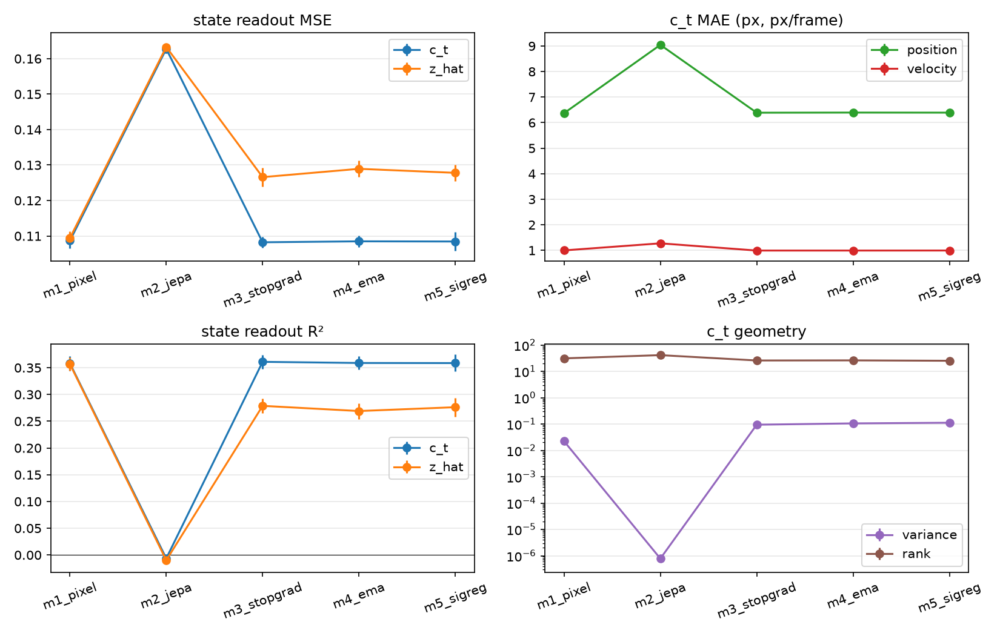

# Phase 1: what does JEPA learn on Moving MNIST?

## Question

Given two context frames `(x_{t-1}, x_t)` and a fixed horizon `k=4`, which
training objective produces context features `c_t` that best predict the future
state of both digits under a common frozen-feature readout?

The comparison is deliberately external: every arm is evaluated by the same
MLP readout trained after the model on `c_t` and `z_hat`.

## Arms

- **M1 pixel:** pixel-only reconstruction.
- **M2 JEPA:** shared encoder target, no stop-gradient.
- **M3 JEPA:** stop-gradient target.
- **M4 JEPA:** EMA target encoder, decay 0.996.
- **M5 JEPA:** EMA target plus SIGReg on `c_t`, weight 0.03.

All arms use the same encoder, fusion, predictor, data, and readout protocol.
Five seeds, 5,000 steps, 10,000 sequences.

## Results

Mean ± std over five seeds.

| Arm | c_t MSE | c_t R² | z_hat MSE | c_t variance | c_t cosine | c_t rank |
|---|---:|---:|---:|---:|---:|---:|
| M1 pixel | 0.1087 ± 0.0021 | 0.358 ± 0.014 | **0.1094 ± 0.0018** | 0.0224 ± 0.0047 | 0.642 ± 0.091 | 31.3 ± 0.8 |
| M2 JEPA | 0.1628 ± 0.0012 | -0.007 ± 0.003 | 0.1633 ± 0.0010 | 7.8e-7 ± 2.0e-7 | 1.000 ± 0.000 | 41.4 ± 2.1 |
| M3 stop-grad | **0.1082 ± 0.0016** | **0.361 ± 0.013** | 0.1266 ± 0.0026 | 0.0945 ± 0.0066 | 0.312 ± 0.016 | 26.0 ± 1.2 |
| M4 EMA | 0.1085 ± 0.0017 | 0.359 ± 0.013 | 0.1289 ± 0.0023 | 0.1061 ± 0.0059 | 0.309 ± 0.013 | 26.2 ± 0.7 |
| M5 SIGReg | 0.1084 ± 0.0026 | 0.359 ± 0.016 | 0.1278 ± 0.0023 | 0.1123 ± 0.0062 | 0.391 ± 0.069 | 25.3 ± 1.3 |

Position/velocity MAE for the `c_t` readout (pixels, pixels/frame):

| Arm | position | velocity |
|---|---:|---:|
| M1 pixel | 6.370 ± 0.110 | 0.998 ± 0.011 |
| M2 JEPA | 9.045 ± 0.058 | 1.275 ± 0.003 |
| M3 stop-grad | 6.389 ± 0.111 | 0.992 ± 0.008 |
| M4 EMA | 6.394 ± 0.133 | 0.992 ± 0.007 |
| M5 SIGReg | 6.392 ± 0.096 | 0.994 ± 0.013 |

## Conclusions

### 1. No asymmetry collapses

M2 has essentially zero feature variance, cosine ~1, and a high centered rank.
Its state readout is the mean predictor (`R² ~= 0`). The low latent loss is the
signature, not evidence of a useful representation.

### 2. Stop-gradient is the minimal fix

M3 restores state prediction to the same level as the pixel baseline and the
EMA variant. It is the simplest successful arm.

### 3. EMA adds no measurable state benefit

M4 is within noise of M3 on `c_t` and slightly worse on `z_hat`. At decay 0.996,
the moving target does not buy additional state information.

### 4. SIGReg does not improve state prediction

M5 is tied on `c_t` and slightly worse than M3 on `z_hat`. It changes the
geometry — higher variance, higher cosine — without improving the readout.

### 5. The pixel baseline remains competitive

M1 is compressed but useful: low variance and high cosine relative to M3/M4,
yet the same `c_t` state MSE. Its `z_hat` readout is the best of all arms
(`0.1094` vs `~0.128` for JEPA). The pixel predictor preserves state information
that the JEPA predictor loses.

### 6. State predictability is the bottleneck

All non-collapsed arms land at `R² ~= 0.36`. Changing the objective changes how
the representation is organized, not how much future state is recoverable from
two frames at `k=4`.

## Phase 1 takeaway

For future-state prediction from two frames:

- JEPA without asymmetry fails outright.
- Any asymmetry recovers a usable representation.
- Stop-gradient is sufficient; EMA and SIGReg do not improve the metric.
- Pixel reconstruction is a strong baseline that JEPA matches but does not beat.
- A JEPA case cannot rest on this state metric alone.

## Limitations

- One task: Moving MNIST, `m=2`, `k=4`.
- One encoder/predictor architecture.
- State is a low-dimensional, pixel-aligned target; it may favor reconstruction.
- Readout capacity is fixed and itself adds variance.
- No actions, planning, or control.

## Phase 2

The next useful axes are context length `m` and horizon `k`:

- `m ∈ {2, 4, 8}` at fixed `k`;
- separate models per `k`;
- a k-conditioned predictor trained across horizons.

The phase-1 code keeps `k` in the data protocol and per-arm config, but the
fusion currently assumes exactly two context frames.
