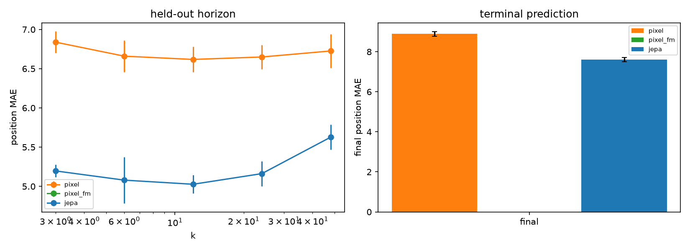

# Phase 2 seeds

| metric | pixel | pixel-FM | JEPA |
|---|---:|---:|---:|
| c_t_state_k3_position_mae | 6.8383 ± 0.1381 (n=5) |  | 5.1969 ± 0.0806 (n=5) |
| c_t_state_k24_position_mae | 6.6491 ± 0.1539 (n=5) |  | 5.1624 ± 0.1603 (n=5) |
| c_t_state_k48_position_mae | 6.7258 ± 0.2164 (n=5) |  | 5.6269 ± 0.1595 (n=5) |
| c_t_state_final_position_mae | 8.8912 ± 0.1095 (n=5) |  | 7.6112 ± 0.1038 (n=5) |
| c_t_digit_accuracy | 0.0254 ± 0.0069 (n=5) |  | 0.0206 ± 0.0022 (n=5) |
| c_t_bounce_accuracy | 0.8000 ± 0.0104 (n=5) |  | 0.8386 ± 0.0144 (n=5) |
| c_t_bounce_balanced_accuracy | 0.7528 ± 0.0124 (n=5) |  | 0.7975 ± 0.0147 (n=5) |
| c_t_variance | 0.5307 ± 0.0190 (n=5) |  | 0.2655 ± 0.0150 (n=5) |
| c_t_cosine | 0.4911 ± 0.0183 (n=5) |  | 0.7136 ± 0.0166 (n=5) |
| c_t_rank | 59.6038 ± 0.4633 (n=5) |  | 23.6041 ± 0.3500 (n=5) |

Final position MAE by context length:

| m | pixel | pixel-FM | JEPA |
|---:|---:|---:|---:|
| 3 | 8.891 ± 0.203 |  | 7.773 ± 0.212 |
| 6 | 9.067 ± 0.340 |  | 7.665 ± 0.265 |
| 12 | 8.735 ± 0.216 |  | 7.424 ± 0.393 |

