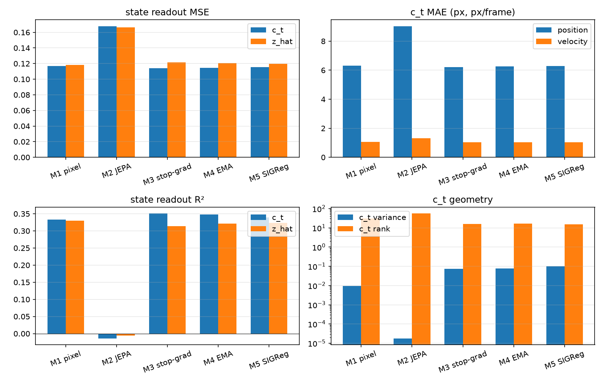
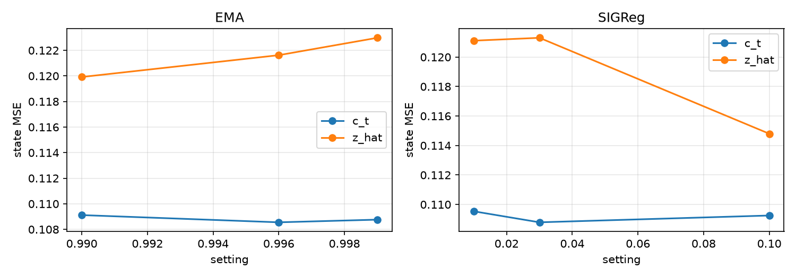

# Run comparison

## Main arms

| arm | loss | persistence | c_t_mse | c_t_pos_mae | c_t_vel_mae | c_t_r2 | z_mse | z_r2 | c_t_var | c_t_cos | c_t_rank | num_samples | num_steps |
|---|---|---|---|---|---|---|---|---|---|---|---|---|---|
| M1 pixel | 0.02878 | 0.05897 | 0.117 | 6.302 | 1.059 | 0.3335 | 0.1183 | 0.3303 | 0.009689 | 0.937 | 31.09 | 2000 | 1500 |
| M2 JEPA | 0.0001824 | 6.866e-05 | 0.1676 | 9.015 | 1.305 | -0.01417 | 0.1663 | -0.005783 | 1.77e-05 | 1 | 55.52 | 2000 | 1500 |
| M3 stop-grad | 0.05653 | 0.1808 | 0.114 | 6.206 | 1.043 | 0.3507 | 0.1214 | 0.3134 | 0.07359 | 0.6893 | 15.75 | 2000 | 1500 |
| M4 EMA | 0.05673 | 0.191 | 0.1143 | 6.255 | 1.036 | 0.3474 | 0.1204 | 0.3211 | 0.07718 | 0.6757 | 16.37 | 2000 | 1500 |
| M5 SIGReg | 0.054 | 0.1866 | 0.1155 | 6.295 | 1.045 | 0.3394 | 0.1198 | 0.3236 | 0.1003 | 0.8879 | 14.99 | 2000 | 1500 |

## Sweeps

| sweep | setting | c_t_mse | z_mse | c_t_r2 | c_t_var | c_t_cos | c_t_rank |
|---|---|---|---|---|---|---|---|
| EMA | 0.99 | 0.1091 | 0.1199 | 0.3516 | 0.08805 | 0.4426 | 21.66 |
| EMA | 0.996 | 0.1086 | 0.1216 | 0.3556 | 0.08593 | 0.4472 | 21.38 |
| EMA | 0.999 | 0.1088 | 0.123 | 0.3552 | 0.07496 | 0.458 | 21.86 |
| SIGReg | 0.01 | 0.1095 | 0.1211 | 0.3494 | 0.08971 | 0.4562 | 21.4 |
| SIGReg | 0.03 | 0.1088 | 0.1213 | 0.3511 | 0.1087 | 0.6259 | 20.9 |
| SIGReg | 0.1 | 0.1093 | 0.1148 | 0.3475 | 0.245 | 0.9394 | 18.71 |

- Best EMA by c_t MSE: 0.996 (0.1086)
- Best SIGReg by c_t MSE: 0.03 (0.1088)

